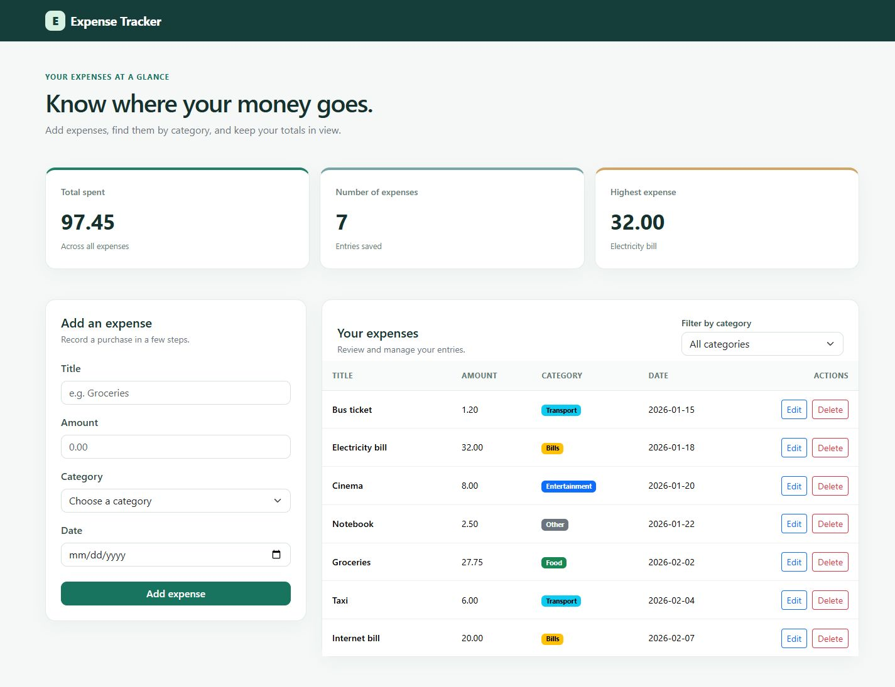
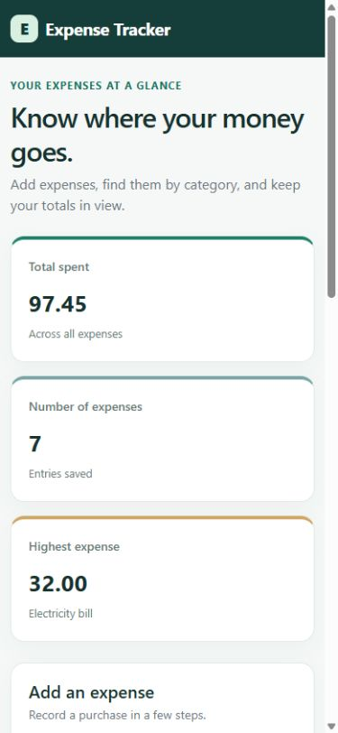
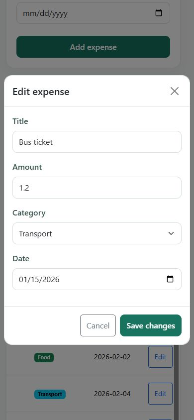

> **Note:** In VS Code, press `Ctrl + Shift + V` to view this README with clear formatting and images.

# Expense Tracker

A web app for keeping track of personal expenses. You can add, edit, delete, and filter expenses. The app saves your data in a PostgreSQL database.

GitHub repository: [First Project](https://github.com/AbdallahAlshiekhAbdallah/First-Project-.git).

## Project explanation

[expense-tracker-explanation](https://drive.google.com/file/d/1XifG3JOySya8l1mNBkYLkm9IZdH81GlH/view?usp=drive_link)

## Features

- Add an expense with a title, amount, category, and date.
- Edit or delete saved expenses.
- Filter expenses by category.
- See the total amount, number of expenses, and highest expense.
- Keep saved expenses after refreshing the page or restarting the server.
- Show messages when an entry is wrong or data cannot load.
- Use the app on desktop and phone screens.

## Bonus Features

- See a doughnut chart and totals showing spending in each category.
- Filter expenses by month and year, together with the category filter.
- Search expenses by title while typing, together with the category and month filters.
- Sort expenses by clicking the Title, Amount, Category, or Date table heading.
- Export the displayed expenses to a CSV file, keeping the current filters and sort order.
- Switch between light and dark mode and remember your choice in the browser.

## Tools used

- **Frontend:** HTML, CSS, JavaScript, Bootstrap, and Chart.js.
- **Backend:** Node.js and Express.
- **Database:** PostgreSQL.

## Project structure

```text
expense-tracker-starter/
├── frontend/
│   ├── index.html
│   ├── Images/
│   │   └── favicon.png
│   ├── css/style.css
│   └── js/ (app.js and theme.js)
├── backend/
│   ├── server.js
│   ├── schema.sql
│   ├── .env.example
│   ├── package.json
│   └── package-lock.json
├── Images/
├── .gitignore
└── README.md
```

## How to run the project

### 1. Get the tools ready

Install Node.js with npm, PostgreSQL with pgAdmin, and the Live Server extension in VS Code. Open the `expense-tracker-starter` folder in VS Code.

### 2. Set up the database

1. Open pgAdmin and connect to your PostgreSQL server.
2. Create a database named `expense_tracker`.
3. Open the Query Tool for this database.
4. Open [backend/schema.sql](backend/schema.sql) and run the full script.

The script creates the expenses table and adds eight sample expenses. Running it again deletes the current expenses and adds the sample data again.

### Updating an existing database

If your database was created before the Health category was added, run this SQL in pgAdmin's Query Tool for `expense_tracker`. It updates the category constraint and keeps your saved expenses.

This uses the default constraint name created by the project's schema.

```sql
BEGIN;

ALTER TABLE expenses
DROP CONSTRAINT expenses_category_check;

ALTER TABLE expenses
ADD CONSTRAINT expenses_category_check
CHECK (category IN ('Food', 'Transport', 'Bills', 'Entertainment', 'Other', 'Health'));

COMMIT;
```

New databases created using the current `backend/schema.sql` already support Health.

### 3. Set up the server

Open a terminal in the project folder and run:

```powershell
cd backend
Copy-Item .env.example .env
```

Open `.env` and enter your PostgreSQL connection details:

```dotenv
DB_HOST=localhost
DB_PORT=5432
DB_USER=postgres
DB_PASSWORD=replace_with_your_password
DB_NAME=expense_tracker
PORT=3000
```

Use your own database username, password, and database port. Keep the app server on port `3000`, because the frontend uses it. Do not share your `.env` file.

Then run:

```powershell
npm install
npm start
```

Keep this terminal open while using the app. You can check the server and database by opening `http://localhost:3000/api/expenses` in your browser. It should show the saved expenses.

### 4. Open the app

Right-click [frontend/index.html](frontend/index.html) in VS Code and choose **Open with Live Server**.

Keep the app server running.

To stop the server, press `Ctrl+C` in the terminal. To start it again, run `npm start` from the `backend` folder.

## How to use the app

- **Add:** fill in the four fields and click **Add expense**.
- **Edit:** click **Edit**, change the details, and click **Save changes**.
- **Delete:** click **Delete** and confirm.
- **Category filter:** choose a category, or choose **All categories** to include every category.
- **Dark mode:** click **Dark mode** in the top bar to switch themes; click it again to return to light mode. Your choice is saved in this browser for your next visit. Until you choose a theme, the app follows your device's light/dark setting. If browser storage is blocked, switching still works for the current page. Forms, tables, dialogs, and chart tooltips match the selected theme.
- **Month filter:** choose a month and year in **Filter by month**, such as **October 2026**. Available months come from saved expenses, newest first. Choose **All months** to remove the month filter. It works together with category filtering and title search. Your selected month stays selected after adding, editing, or deleting an expense.
- **Search:** type part of a title in **Search by title**. Matching ignores uppercase and lowercase; clear the search to show all titles that match the selected category and month. The summary always includes all expenses.
- **Sort:** click **Title**, **Amount**, **Category**, or **Date** in the table header. The first click sorts A–Z, lowest amount first, or oldest date first. Click the same heading again to reverse the order; the arrow shows the current direction. Sorting a different column starts in ascending order. Sorting works with all filters and stays active after adding, editing, or deleting expenses. You can also focus a heading with Tab and press Enter or Space. The summary and chart always include all expenses.
- **Category chart:** the **Expenses by category** chart shows the total amount spent in each category, including Health. Hover over a slice (or tap it on a phone) to see its amount. The totals beside it are also readable without using the chart. Adding, editing, or deleting an expense updates the chart automatically. Like the summary cards, the chart always includes all expenses, regardless of table filters. With no expenses, it shows a prompt to add one.

Chart.js loads from a CDN, like Bootstrap, so an internet connection is needed to load the chart library. If it cannot load, the category totals are still shown and the rest of the app remains usable.

### Exporting expenses

Click **Export CSV** above the table to download `expenses-YYYY-MM-DD.csv`, named with today's date. The file contains **Title, Amount, Category, and Date** for the rows currently shown, in their current sort order. To export everything, clear the title search and select **All categories** and **All months**. The button is disabled while expenses are loading or when no rows match.

Open the file in a spreadsheet app, such as Excel, or import it as a comma-separated UTF-8 file. Amounts use two decimal places and dates use `YYYY-MM-DD`. Arabic text, commas, quotes, and line breaks are preserved. Formula-like text receives a leading tab to reduce formula execution during spreadsheet import; that tab is part of the exported value. Exporting does not change saved expenses.

If Excel shows `#######` in the **Date** column, double-click the right edge of the **D** column heading to fit the dates. The dates are still present; the column is just too narrow. CSV files cannot store column widths or display formatting.

## Input rules

| Field | Rule |
| --- | --- |
| Title | Required, with no more than 100 characters. |
| Amount | Greater than zero, with up to two decimal places. |
| Category | Food, Transport, Bills, Entertainment, Other, or Health. |
| Date | A valid date in `YYYY-MM-DD` format. |

## API

The API lets the frontend read and change saved expenses.

| Request | What it does |
| --- | --- |
| `GET /api/expenses` | Get all expenses. |
| `GET /api/expenses/:id` | Get one expense by its ID. |
| `POST /api/expenses` | Add an expense. |
| `PUT /api/expenses/:id` | Edit (Update) an expense. |
| `DELETE /api/expenses/:id` | Delete an expense. |

To test adding or editing an expense in Thunder Client, choose **Body → JSON** and use:

```json
{
  "title": "Coffee",
  "amount": 2.5,
  "category": "Food",
  "date": "2026-10-01"
}
```

API test screenshots are in the [Images folder](Images/).

## Screenshots

### Desktop

The page shows the summary, add form, category filter, and expense table.



### Phone

The summary cards appear in one column.



### Editing on a phone

The edit window lets you change an expense and save it.



## Main challenges

Connecting the page to the server and database takes several steps. The page uses `fetch` to send requests, and the server reads or changes data in PostgreSQL. After adding, editing, or deleting an expense, the page loads the updated list and summary.

CSS Grid arranges the summary cards in one, two, or three columns to fit the screen size.

## Common problems

- **Database error:** check that PostgreSQL is running, the `.env` details are correct, and the database table was created.
